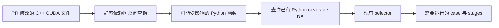

<!-- SPDX-FileCopyrightText: Copyright (c) 2026 NVIDIA CORPORATION & AFFILIATES. All rights reserved. -->
<!-- SPDX-License-Identifier: Apache-2.0 -->

# CBTS C++ 变更选例原理与开发交接

C++ 变更能否复用现有 Python coverage data 和 selector 来筛选测试，是目前这项工作的核心问题。已有实验采用的路线是：**用静态分析建立 C++ 代码到 Python 函数的映射，再查询 Python coverage data，交给现有 selector 生成测试清单。**

可用于静态分析的两种工具是 Tree-sitter 和 libclang；动态 C++ coverage 工具是 BullseyeCoverage。当前 worktree 的实验实现使用 Tree-sitter，libclang 是可进一步比较的静态分析方案。Bullseye 尚未接入本次 CBTS 实验，是否值得增加动态 C++ coverage 收集，仍需评估投入产出比。

后续开发可以先固定一组修改了 C++/CUDA 的 PR，用本地 dry-run 对比算法变化，重点观察 **hit rate** 和 **skip rate**。先用这两个指标判断静态映射的适用范围和裁剪效果，再决定是否投入动态采集。

## 1 三种工具的原理与基本用法

### 1.1 Tree-sitter

Tree-sitter 按语言语法把源码转换成语法树。遍历树可以识别函数定义、调用表达式、类、命名空间及其源码位置；也支持源码修改后的增量解析。它无需先编译整个项目，适合快速扫描大量文件。[官方介绍](https://tree-sitter.github.io/tree-sitter/)

例如，对 `obj.run(x)`，它能识别这是调用表达式，取出 `obj.run` 和调用位置；要确定 `obj` 的类型、具体调用哪个重载，通常还需要自己补充解析规则。因此在 CBTS 中，Tree-sitter 提供语法结构，matcher 负责把结构连接成依赖关系。

Python 基本用法如下，采用本 worktree 实验使用的版本：

```bash
python3 -m pip install tree-sitter==0.25.2 tree-sitter-cpp==0.23.4
```

```python
from tree_sitter import Language, Parser
import tree_sitter_cpp

source = b"int add(int a, int b) { return a + b; }"
parser = Parser(Language(tree_sitter_cpp.language()))
tree = parser.parse(source)
for node in tree.root_node.named_children:
    print(node.type, node.start_point, node.end_point)
```

后续可遍历 `function_definition`、`call_expression` 等节点，提取函数和调用。Python API 参见 [py-tree-sitter 文档](https://tree-sitter.github.io/py-tree-sitter/)。

### 1.2 libclang

libclang 是 Clang 编译器前端提供的库接口。它按具体编译参数解析一个 translation unit，也就是某个源文件及其包含的头文件，并暴露 AST、类型、符号引用和源码位置。相比只按语法匹配，它能利用编译上下文帮助解析调用目标。[官方教程](https://clang.llvm.org/docs/LibClang.html)

典型用法是安装匹配版本的 libclang 和 Python `clang.cindex` bindings，创建 Index、解析源文件，再遍历 cursor：

```python
from clang import cindex

index = cindex.Index.create()
tu = index.parse("example.cpp", args=["-std=c++17", "-Iinclude"])
for diagnostic in tu.diagnostics:
    print(diagnostic)
for node in tu.cursor.walk_preorder():
    if node.kind == cindex.CursorKind.CALL_EXPR:
        target = node.referenced
        print(node.location, target.spelling if target else "unresolved")
```

这是独立 C++ 文件的入门示例。真实项目通常从 `compile_commands.json` 取得每个源文件的工作目录、宏定义、include 路径和语言选项；需要先准备好相应依赖和生成头文件。编译数据库格式见 [Clang 文档](https://clang.llvm.org/docs/JSONCompilationDatabase.html)，Python 接口见 [官方 bindings](https://github.com/llvm/llvm-project/blob/main/clang/bindings/python/clang/cindex.py)。

对 TensorRT-LLM，后续需要验证 CUDA/nvcc 参数适配、模板、宏和多种构建配置下的解析效果。libclang 有助于补强语义信息，但不会直接生成“哪个测试实际执行过哪个 C++ 函数”的动态数据。

### 1.3 BullseyeCoverage

BullseyeCoverage 是动态 C/C++ coverage 工具。它在构建时对源码插桩，测试运行时记录插桩点是否执行，输出函数覆盖及 condition/decision coverage 等结果。使用它需要重新构建并运行测试。[官方功能说明](https://www.bullseye.com/product.html)

在已安装、配置好 Bullseye 编译器 wrappers 的 Linux 环境中，通用 C++ 项目的基本流程如下：

```bash
export COVFILE=/path/to/output/test.cov
cov01 --on
cmake --build /path/to/build --clean-first
cov01 --off
/path/to/instrumented_test
covhtml --file "$COVFILE" /path/to/output/html
```

这里的 build/test 路径是示意，需要替换为实际项目配置；`cov01` 控制构建插桩，运行阶段使用构建时产生的 coverage 文件。命令用法见 [Quick Start](https://www.bullseye.com/help/quickStart.html)、[cov01](https://www.bullseye.com/help/ref-cov01.html) 和 [covhtml](https://www.bullseye.com/help/ref-covhtml.html)。

如果用于 CBTS，还需要保留 **每个 case 对应的 C++ coverage**。把所有测试结果合并成一份总体覆盖率，只能说明整套测试覆盖了什么，无法直接反查某个函数应该运行哪些 case。独立测试进程可从同一构建的 coverage 文件副本开始分别采集；长生命周期服务和多个 case 共用进程的归属方式需要额外设计。[运行及 coverage 文件说明](https://www.bullseye.com/help/run.html)

Bullseye 在 TensorRT-LLM 的实际构建兼容性、采集开销，以及 CUDA device code 的可测范围，尚未在本次实验中验证。

### 1.4 对 CBTS 的作用比较

| 工具 | 输入与输出 | 在 C++ 选例中的用途 | 主要成本 |
|---|---|---|---|
| Tree-sitter | 源码 → 语法树、位置、调用候选 | 快速建立 C++ 与 Python 入口之间的静态映射 | 自行维护符号和调用解析规则 |
| libclang | 源码及编译配置 → AST、类型与符号引用 | 尝试提高复杂 C++ 调用和依赖关系的解析能力 | 准备构建上下文、适配参数、处理解析失败 |
| BullseyeCoverage | 插桩构建及测试运行 → 实测 coverage | 建立 case 到 C++ 代码的动态关系 | 插桩构建、重跑测试、case 归属、运行和维护开销 |

Tree-sitter 与 libclang 都可服务于静态映射方案。Bullseye 对应另一种数据来源，是否引入应由实测收益与成本决定。

## 2 CBTS 已有的 Python coverage data 和 selector

### 2.1 Python coverage data

现有 collector 使用 Python 3.12+ 的 `sys.monitoring.PY_START`，记录每个测试进入过的产品函数。逻辑数据形式为：

```text
(stage / pytest nodeid, Python 文件, 函数 qualname)
```

例如：

```text
A100-PyTorch / tests/...::test_example
    -> tensorrt_llm/example.py :: Example.run
```

每个进程保存 SQLite，之后合并为 `cbts_touchmap.sqlite`。selector 因而可以反查：**哪些测试进入过 `example.py::Example.run`？**

这份数据提供的是 Python 函数粒度的执行记录，当前没有记录 C++ 函数执行。worker import、closure、Ray worker 等采集盲区及完整性机制见 [COLLECTION.md](../coverage_utils/COLLECTION.md)。

### 2.2 Python selector

现有选择过程分两层：

1. Tier 1 用规则处理测试定义、文档等可识别变更。
2. Tier 2 对规则未处理的文件计算影响。对于 Python 变更，把 diff 对应到函数，再从 coverage DB 查询相关测试，生成收窄后的 stages 和 test-db YAML。

selector 还会保留无数据、采集不完整或无法精确拆分的测试。无法建立影响范围时回退到完整运行。Python import/binding 等变化由当前上游的静态分析和引用检查处理，细节见 [SELECTION.md](SELECTION.md)。

C++ 静态映射实验复用了这套后半段能力：只要找到受影响的 Python 函数，就能查询已有 coverage data，并继续使用现有的选例和 YAML 裁剪逻辑。

## 3 已有 C++ 实验做了什么

### 3.1 实验路线



依赖图的构建方向是从 Python 入口沿调用向 C++ 扩展；PR 分析时按被修改的 C++ 文件反向查询。因此当前方法由两部分组成：

```text
静态关系：Python 函数 -> native 注册入口 -> C++ 调用与文件
动态关系：case -> 实际进入过的 Python 函数
```

把两者连接起来，就能从 C++ 变更得到候选 case。**这里用到的动态数据仍然是现有 Python coverage，没有新增动态 C++ coverage 采集。**

### 3.2 当前实现

[build_native_codegraph.py](../tools/build_native_codegraph.py) 负责生成 `cbts_codegraph.sqlite`：

1. 扫描 Python 函数中的直接 `torch.ops`、部分 `tensorrt_llm.bindings` 调用，找到 Python/native 边界。
2. 匹配 torch 与 nanobind 注册，关联到 C++ 实现入口。
3. 使用 Tree-sitter 分析 C++ 函数定义、调用表达式，按现有 matcher 规则继续扩展，默认最多 5 hops。
4. 增加直接项目头文件关系，保存 Python 函数到 native 文件的映射。

通用 builder 的 Python 扫描使用标准库 `ast`；C++ 扫描使用 Tree-sitter。底层 matcher 在 [case_native_dependency_demo.py](../tools/case_native_dependency_demo.py)。当前 worktree 没有接入 libclang；`compile_commands.json` 用于筛选构建源文件及记录来源，没有执行 Clang 语义分析。

静态库核心关系为：

```text
python_native_file(
    python_file, python_qualname, native_file, min_hops, evidence
)
```

[native_graph.py](native_graph.py) 按 native 文件反查 Python 函数，selector 再调用 `TouchDB.tests_touching_func()` 查询 case。目前 native 变更按文件粒度处理，没有进一步把 C++ diff 精确到被修改函数。

例如，本地历史图中存在：

```text
cpp/tensorrt_llm/batch_manager/capacityScheduler.cpp
    -> scheduler.py::BindCapacityScheduler.__init__
    -> 进入过这个 Python 函数的历史 case
```

### 3.3 已有结果说明了什么

[历史 demo](NATIVE_CODEGRAPH_DEMO_RESULTS.md) 记录了以下结果：

| PR | production native 文件已映射数 | 关联 Python 入口 | 关联 case | 当时整 PR 决策 |
|---|---:|---:|---:|---|
| #13880 | 1/1 | 14 | 391 | coverage |
| #18081 | 3/3 | 6 | 17 | fallback |
| #18202 | 1/1 | 1 | 248 | fallback |

后两项当时分别被同 PR 中的 Python closure、import-executed 变更阻断。它们说明“C++ 找到了 Python 入口”和“整 PR 能成功选择测试”是两个不同结果。

这些是旧源码和旧数据下的实验记录，不能当作当前基线的 hit rate。历史 x86 图还有缺失构建源文件、未解析调用等问题；目前也未比较 Bullseye 的收益。

### 3.4 后续开发先处理的入口问题

当前 worktree 已 rebase 到 `69a455ae974bcf9582c9a2cc4f7fd9a5f75680fe`。上游新增的 `coverage_tier.coverage_preflight()` 只接受 core Python residual，会在进入底层 native selector 前拦下 C++ 文件。

因此接手后应先适配这个 preflight 与 native 图的入口，再进行完整链路评估。底层 matcher/selector 单测已经存在，但不代表 rebase 后 native PR 的 CLI 路径已经打通。未适配时，dry-run 中可能看到 `non-core-Python residual file` 回退，需要把它归为入口问题。

## 4 后续怎样用本地 dry-run 评估

### 4.1 先固定修改 C++ 的 PR 样本

从约定的历史窗口筛选包含 C++/CUDA 源码或头文件变更的 PR，保存精确 SHA 列表。建议同时标记：production C++、C++ 测试代码，以及混合修改了 Python/CMake 的 PR。

筛选的是 **PR 样本**。运行时仍输入该 PR 的全部 changed files，不能把其中 Python、CMake 等文件移除，否则会高估完整 PR 的 hit rate。若从主线 first-parent commit 取样，应说明样本单位是合入 commit，并保留对应 PR 号。

当前 `dryrun.py --filter` 只有 `tests-only` 和 `all`，没有 C++ 专用过滤选项。可以先在 Git 历史中筛出 SHA，再通过可重复的 `--sha` 参数传入。例如，以下代码展示如何生成一份候选列表；200 是示例窗口大小，正式比较应沿用约定 cohort：

```python
from pathlib import Path
import json
import subprocess


def git(*args):
    return subprocess.check_output(["git", *args], text=True).strip()


tip = git("rev-parse", "upstream/main")
shas = git("rev-list", "--first-parent", "--max-count=200", tip).splitlines()
suffixes = {".c", ".cc", ".cpp", ".cxx", ".cu", ".cuh", ".h", ".hpp"}
samples = []
for sha in shas:
    files = git("diff", "--name-only", f"{sha}^", sha).splitlines()
    native = [p for p in files if p.startswith("cpp/") and Path(p).suffix in suffixes]
    if native:
        samples.append({"sha": sha, "subject": git("show", "-s", "--format=%s", sha),
                        "native_files": native})
Path("/private/tmp/cbts-cpp-cohort.json").write_text(
    json.dumps({"tip": tip, "samples": samples}, indent=2) + "\n"
)
```

### 4.2 准备两份输入

| 输入 | 用途 |
|---|---|
| `cbts_touchmap.sqlite` | 已有 Python coverage data，回答 Python 函数关联哪些 case |
| `cbts_codegraph.sqlite` | 静态映射，回答 native 文件关联哪些 Python 函数 |

A/B 对比固定同一份 Python coverage DB、同一 cohort、相同 trigger mode 和 Python 策略。比较静态算法改进时，仅替换对应 codegraph 或解析算法。应记录源码版本、构建配置、依赖版本和制品 hash。

#### Python SQLite 从哪里获取

Python coverage DB 来自官方主线 PostMerge 构建，不需要接手同事在本地重跑测试采集。

- 生产任务：[LLM/main/L0_PostMerge](https://prod.blsm.nvidia.com/sw-tensorrt-top-1/job/LLM/job/main/job/L0_PostMerge/)。
- 制品目录：`https://urm.nvidia.com/artifactory/sw-tensorrt-generic/llm-artifacts/LLM/main/L0_PostMerge/<BUILD_NUMBER>/cbts-coverage/`。
- 对应源码版本：同一 build 根目录下的 `build_info.txt`，读取其中的 `commit=`。

需要能够访问 NVIDIA 内部 Jenkins 和 Artifactory。先选定一个同时具有下列双架构归档及 `build_info.txt` 的 build；A/B 及后续算法比较持续使用这个 build。初次选取可查看最新完整构建，复现实验则使用实验记录指定的构建，不能中途替换成更新数据。

| 归档 | 内容与用途 |
|---|---|
| `cbts_pystart_report_x86_64.tar.gz` | x86_64 的 Python coverage SQLite，正式 selector 的输入之一 |
| `cbts_pystart_report_SBSA.tar.gz` | SBSA 的 Python coverage SQLite，与同 build 的 x86_64 数据合并 |
| `cbts_pystart_report.tar.gz` | 后续 Test Coverage 阶段生成的完整报告包，含合并 SQLite 和 `cbts_report/` HTML，可用于本地分析与浏览 |

**推荐本地评估沿用正式 selector 的双架构合并口径。** 两个架构归档内部都叫 `cbts_touchmap.sqlite`，要解压到不同目录，再合并，避免覆盖或只拿到单架构数据。完整报告包是另一种可用来源，应记录所用包的类型，比较时保持一致。

在仓库根目录运行以下命令。先把 shell 变量 `CBTS_COV_BUILD` 设置为选定的数字构建号；命令不会自动改用其他 build。

```bash
CBTS_COV_BUILD="${CBTS_COV_BUILD:?请先设置选定的 PostMerge 构建号}"
CBTS_COV_DIR="/private/tmp/cbts-python-coverage-${CBTS_COV_BUILD}"
CBTS_COV_URL="https://urm.nvidia.com/artifactory/sw-tensorrt-generic/llm-artifacts/LLM/main/L0_PostMerge/${CBTS_COV_BUILD}"
mkdir -p "$CBTS_COV_DIR"
curl --fail --location --retry 3 \
  "$CBTS_COV_URL/build_info.txt" \
  --output "$CBTS_COV_DIR/build_info.txt"

for cbts_arch in x86_64 SBSA; do
  mkdir -p "$CBTS_COV_DIR/$cbts_arch"
  curl --fail --location --retry 3 \
    "$CBTS_COV_URL/cbts-coverage/cbts_pystart_report_${cbts_arch}.tar.gz" \
    --output "$CBTS_COV_DIR/cbts_pystart_report_${cbts_arch}.tar.gz"
  tar -xzf "$CBTS_COV_DIR/cbts_pystart_report_${cbts_arch}.tar.gz" \
    -C "$CBTS_COV_DIR/$cbts_arch"
done

python3 jenkins/scripts/cbts/coverage_utils/pystart_report.py \
  --glob "$CBTS_COV_DIR/*/cbts_touchmap.sqlite" \
  --out-sqlite "$CBTS_COV_DIR/cbts_touchmap.sqlite"
shasum -a 256 "$CBTS_COV_DIR/cbts_touchmap.sqlite"
```

最终将 `$CBTS_COV_DIR/cbts_touchmap.sqlite` 传给 `dryrun.py --coverage-db`。保留构建号、`build_info.txt`、下载 URL、归档类型和 SQLite SHA-256；之后的 baseline 与改进版本使用同一路径/相同 hash。建议使用新的输出目录，保留既有实验数据。

仓库也有 [artifact.py](artifact.py) 自动执行 CI 的解析、下载和合并流程，但其 `--prepare` 需要 `--pr-head`、`--paths-json` 等信息，并会检查 PR residual 与 DB revision 的兼容性；它不是只给 build 号就能下载的命令。上面的手工取数适用于固定数据的本地算法回放，不代表已经通过生产 CI 的 PR 兼容性检查。

#### 静态映射 SQLite 如何构建

静态图的现有构建命令：

```bash
uv run --no-project \
  --with tree-sitter==0.25.2 \
  --with tree-sitter-python==0.25.0 \
  --with tree-sitter-cpp==0.23.4 \
  python -B jenkins/scripts/cbts/tools/build_native_codegraph.py \
  --repo-root . \
  --compile-commands /path/to/build/compile_commands.json \
  --compile-commands-source-root /code/tensorrt_llm \
  --output /private/tmp/cbts-cpp-codegraph.sqlite \
  --native-depth 5
```

`compile_commands` 和生成源码应对应被分析的源码/构建配置。已有 `reports/` 下的 SQLite 可用于复现旧实验；它不会随 rebase 自动更新。

### 4.3 运行 baseline 和静态映射版本

以下用同一个 PR 的 SHA 展示命令；批量时给两次运行传入完全相同的 `--sha` 列表：

```bash
python3 jenkins/scripts/cbts/tools/dryrun.py \
  --sha <PR_COMMIT_SHA> \
  --coverage-db "$CBTS_COV_DIR/cbts_touchmap.sqlite" \
  --import-executed-policy analyze \
  --out /private/tmp/cbts-cpp-baseline \
  --repo-root .
```

```bash
python3 jenkins/scripts/cbts/tools/dryrun.py \
  --sha <PR_COMMIT_SHA> \
  --coverage-db "$CBTS_COV_DIR/cbts_touchmap.sqlite" \
  --native-codegraph /private/tmp/cbts-cpp-codegraph.sqlite \
  --import-executed-policy analyze \
  --out /private/tmp/cbts-cpp-with-native \
  --repo-root .
```

baseline 仍使用现有规则和 Python selector；第二次增加 native 映射。dry-run 使用样本 commit 的源码、test-db 和 stage 定义模拟选择，不运行 GPU 测试。默认模拟 pre-merge；如使用 `--post-merge`，两组保持一致。

每次输出用新目录。查看：

| 输出 | 观察内容 |
|---|---|
| `INDEX.md` | 各 PR 的 scope、stages 和回退分布 |
| `pr-*/decision.json` | 完整 PR 是否成功选择、保留数量及原因 |
| `pr-*/native-impact.json` | 各 native 文件映射到的 Python 函数及关联 case |
| `pr-*/summary.txt` 和生成的 YAML | 最终保留/移除的测试条目及具体内容 |

`native-impact.json` 是映射诊断，不包含完整 selector 的全部 fallback 和强制保留逻辑。指标应以 `decision.json` 和最终测试清单为准。

## 5 重点指标

### 5.1 Hit rate

Hit rate 衡量：**固定 C++ PR 样本中，有多少 PR 能成功做出 CBTS 选择，而不是回退完整运行。**

```text
hit rate = 成功选择的 PR 数 / 固定样本 PR 总数
```

对本地候选决策，可用有效 `decision.json` 中 `scope != null` 统计成功选择；同时单列 `scope=coverage` 的数量，观察 coverage 路线贡献。新增 native 映射后，由 fallback 变为可选例的 PR 数，就是这项能力带来的直接增量。

例如 20 个 C++ PR 中，baseline 命中 2 个，增加静态映射后命中 8 个，hit rate 从 10% 变为 40%，新增命中 6 个。这个指标不表示失败测试检出率。

固定样本中的执行错误应单列并保留在分母，不能删掉失败样本后提高命中率。另外应报告实际省掉至少一个测试条目的 PR 数，因为成功产生选择决策也可能没有可裁剪条目。

### 5.2 Skip rate

Skip rate 衡量：**与相同触发模式下的完整测试清单相比，省掉了多少测试条目。**

```text
单 PR skip rate = (完整测试条目数 - 选择后保留条目数) / 完整测试条目数

整个样本的加权 skip rate
    = 1 - sum(各 PR 选择后保留条目数) / sum(各 PR 完整测试条目数)
```

例如完整清单有 1,000 个条目，选择后保留 300 个，该 PR 的 skip rate 为 70%。fallback PR 按完整运行计算，skip rate 为 0，仍计入整体分母。遇到执行错误或无法计数的样本，需要明确标记，修复后再给完整 cohort 的结果。

计数口径应复用 [report_cbts_decision.py::_case_counts](../tools/report_cbts_decision.py) 的 stage family 统计方式：同一 stage 的多个 pytest-split shard 不重复累计同一清单；不同 stage family 分别计数，并纳入该 trigger mode 下的强制保留阶段。这里是 **YAML 测试条目数**，不一定等于 pytest 参数化展开后的全部 case 数，也不直接等于 GPU 时间节省。

汇总时对 fallback 显式令“保留数 = 完整数”；不要直接对空的 `affected_stages` 计数并误算成 100% skip。若 `_case_counts` 返回 `(0, 0)`，表示没有有效计数，不能当作裁剪成功。

### 5.3 建议的比较表

| 方案 | 固定 C++ PR 数 | 命中数 | Hit rate | 整体加权 skip rate | 实际裁剪的 PR 数 | 错误数 |
|---|---:|---:|---:|---:|---:|---:|
| 现有规则与 Python selector | N | 待测 | 待测 | 待测 | 待测 | 待测 |
| 加入当前 Tree-sitter 静态映射 | N | 待测 | 待测 | 待测 | 待测 | 待测 |
| 改进静态解析或引入 libclang | N | 待测 | 待测 | 待测 | 待测 | 待测 |

另外统计主要回退原因，例如 native 文件未映射、入口 preflight 拦截、混合 Python 变更无法处理、CMake residual、coverage 无数据等，方便判断下一轮改进方向。旧 A/B 脚本中的 `coverage_hit_rate_pct` 使用“coverage 尝试数”作为分母，与这里的全 cohort hit rate 不同，引用时需要明确口径。

hit rate 和 skip rate 体现适用范围与裁剪效果；还需要核查新增命中的依赖证据和保留清单，避免因遗漏静态关系而获得虚高的 skip rate。

## 6 是否引入 Bullseye 的评估方法

当前尚未评估动态 C++ coverage 的投入产出比，也没有决定把它作为必须交付的 collector。建议在固定 C++ cohort 上先改进静态方案，再选择少量代表性模块做 Bullseye pilot，比较：

| 方面 | 需要测量的问题 |
|---|---|
| 额外收益 | 能否覆盖静态方案反复失败的 PR？hit rate 能增加多少？ |
| 选择精度 | 能否减少静态过度关联的 case，进一步提高 skip rate？ |
| 构建与运行 | 插桩构建、测试时间、内存及制品大小增加多少？ |
| 接入复杂度 | 是否支持实际工具链？多进程、服务、case 边界如何归属？ |
| 持续维护 | 收集新 coverage 的成本、构建变体、数据新鲜度和排障成本是多少？ |

可采用的动态路线是“C++ 变更 → 实测 C++ coverage → case”，也可以先只用动态数据校验静态映射。最终选择取决于增量收益是否足以覆盖采集和维护成本。

## 7 接手同事的第一轮工作

1. 先适配 rebase 后的 `coverage_preflight`，打通 C++ PR 到 native selector 的完整 dry-run 路径。
2. 固定 C++ PR cohort、Python coverage DB 和运行模式，保存当前 baseline。
3. 在同一组输入上比较 Tree-sitter 静态映射，汇总 hit rate、加权 skip rate 和回退原因。
4. 依据未命中样本，决定优先改进注册解析、头文件/模板关系，还是试验 libclang。
5. 静态方案的收益和主要瓶颈明确后，再评估 Bullseye pilot，决定动态 collector 的投入范围。

静态图存在部分映射、未解析边和源码版本匹配等待完善项，当前 native 路线适合先在本地 dry-run 中迭代。正式用于跳过测试前，需要把映射完整性和无数据回退条件落实到 selector。

## 8 代码入口

| 文件 | 作用 |
|---|---|
| [coverage_utils/COLLECTION.md](../coverage_utils/COLLECTION.md) | 已有 Python 动态采集及数据范围 |
| [touch_db.py](touch_db.py) | 查询 Python 函数关联的测试 |
| [build_native_codegraph.py](../tools/build_native_codegraph.py) | 构建静态 Python/native 映射 |
| [case_native_dependency_demo.py](../tools/case_native_dependency_demo.py) | Tree-sitter 与注册、调用 matcher |
| [native_graph.py](native_graph.py) | 按 native 文件反查 Python 函数 |
| [selector.py](selector.py) | 根据函数影响范围选择 case |
| [coverage_tier.py](../coverage_tier.py) | preflight、规则合并与测试清单裁剪 |
| [dryrun.py](../tools/dryrun.py) | 本地重放 PR 的完整选择决策 |
| [native_impact.py](native_impact.py) | 输出 native 映射诊断 |
| [report_cbts_decision.py](../tools/report_cbts_decision.py) | 统一 stage family 和 skip rate 计数口径 |
| [test_cbts_native_graph.py](../../../../tests/unittest/scripts/test_cbts_native_graph.py) | 已有 matcher、图、selector 和诊断用例 |

本文基于 2026 年 10 月 15 日 worktree；native 实现仍包含未提交及未跟踪文件。旧实验的具体制品与结果见 [NATIVE_CODEGRAPH_DEMO_RESULTS.md](NATIVE_CODEGRAPH_DEMO_RESULTS.md)。
